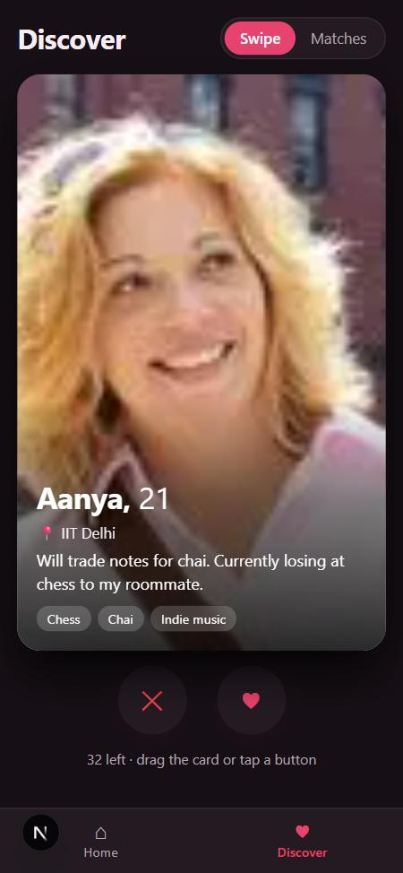
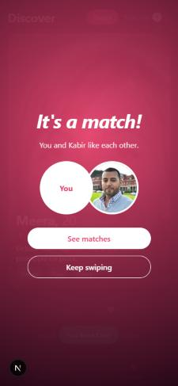
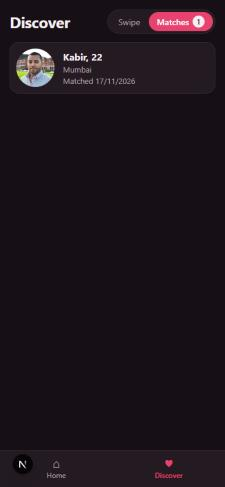
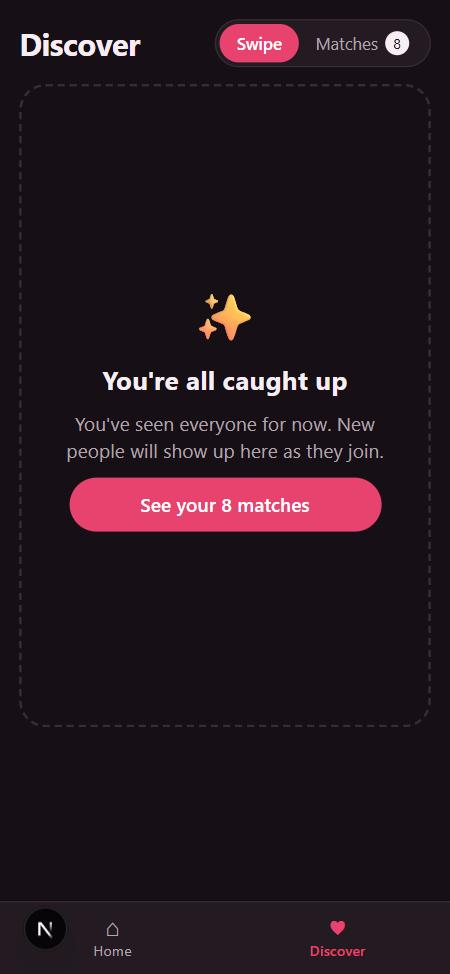

# Coy Discover

A swipe-based **Discover** tab for Coy, built as a standalone Next.js app for the Coy SDE intern assignment. The tab bar has a blank **Home** placeholder and the **Discover** tab, which holds the swipe deck and a **Matches** view.

The Part A write-up (two suggested core features) is in [PART_A.md](PART_A.md).

| Deck | It's a match | Matches | All caught up |
| --- | --- | --- | --- |
|  |  |  |  |

## Run it

You need **Node.js 22.13 or newer**, because the app uses Node's built-in `node:sqlite`. Check with `node -v`.

```bash
git clone https://github.com/DSCmatter/Discover_tab.git
cd Discover_tab
npm install
npm run dev
```

Then open http://localhost:3000.

| Command | What it does |
| --- | --- |
| `npm run dev` | Start the dev server on port 3000 |
| `npm run verify` | Run the typecheck, lint and all tests |
| `npm test` | Run the tests only |
| `npm run build` then `npm start` | Production build and server |
| `npm run reset` | Clear saved swipes and matches to replay the demo (stop the server first) |

**On your phone.** Run `npm run dev` on your laptop, then open `http://<your-laptop-ip>:3000` on a phone on the same Wi-Fi.

**Demo tip.** These seeded profiles already like you, so liking them triggers "It's a match!": Kabir, Ishita, Aditya, Myra, Pari, Tara, Arnav and Neel. Their order in the deck is unrelated to whether they like you.

## Stack

- **Next.js 16 (App Router), React 19, TypeScript.** The UI is mobile-first and renders as a phone-width column on desktop.
- **Next.js route handlers** serve the API at exactly `/feed`, `/swipe` and `/matches`.
- **SQLite via `node:sqlite`.** The file lives at `.data/discover.db`, so swipes and matches survive page reloads and server restarts. You can override the path with `DISCOVER_DB`.
- **`motion`** handles the drag gesture, the card exit animation and the match overlay.
- **Vitest** runs the tests.

## API

| Method | Path | Body | Response |
| --- | --- | --- | --- |
| GET | `/feed` | | `{ profiles: PublicProfile[] }`: profiles not yet swiped |
| POST | `/swipe` | `{ profileId, decision: "like" \| "pass" }` | `{ matched: boolean, match: Match \| null }` |
| GET | `/matches` | | `{ matches: Match[] }`: mutual matches, newest first |

`POST /swipe` returns `400` for a malformed body, `404` for an unknown profile, and `409` if you try to change a decision you already made. Repeating the *same* decision is safe. It returns the original result, so a network retry can't double-record a swipe or create a second match.

## Design

### Data model

- **`Profile`** is the seed data (`src/lib/profiles.ts`), 32 profiles. Only the server knows `likesMe`, the "this person already liked you" flag.
- **`PublicProfile`** is the only shape that crosses the API. `toPublic()` builds it from an **allowlist** of fields. A private field added to `Profile` later stays private unless someone deliberately exposes it.
- **`swipes`** is the only stored state: one table, with `profile_id` as the **primary key**. A profile can only ever be swiped once. The database enforces that, not the client.
- **Matches are derived, not stored.** A match is a `like` swipe on a profile whose `likesMe` is true. A separate matches table would need to stay in sync with swipes. Deriving it means they can never disagree.

The matching rules are pure functions in `src/lib/discover.ts`. `src/lib/store.ts` is the thin SQLite layer that feeds them. The route handlers only parse the request and map outcomes to status codes.

### Privacy: "never reveal who liked you unless it's mutual"

- **The feed never carries the like signal.** `GET /feed` returns `PublicProfile`s only, and a test asserts that the exact key set contains no `likesMe`.
- **Feed order doesn't leak it either.** Profiles come back in seed order, and the likers are spread through it, so nobody can infer "the first few cards like me".
- **A pass looks the same for everyone.** Passing on someone who liked you returns exactly the same response as passing on anyone else.
- **Decisions are final.** This mirrors Coy's "adding is final" rule. You can't pass, then send a like to test whether it would match, because switching a decision returns `409`, and a test covers it.
- **Matches show only mutual likes.** `GET /matches` returns mutual likes only. One-sided likes, in either direction, never appear anywhere.

### Swipe UX

- Drag the card on touch or mouse, or use the ✕ / ♥ buttons on desktop. A swipe commits past 110 px or on a fast flick. Anything shorter springs back.
- **LIKE** and **NOPE** stamps fade in as you drag. The card flies off in the direction you chose. A toast confirms each swipe ("You liked Kabir"), and the next card scales up from behind.
- The UI updates optimistically. If saving fails, the card returns to the top of the deck and an error toast explains why.
- The page is a server component. It reads the initial feed and matches directly, so the client needs no fetch-on-mount effect, and a reload always shows the persisted state.

## Tests

`test/discover.test.ts` covers the domain and storage behavior: seed requirements, the privacy of the feed shape, "never appears again", match and no-match, identical pass responses, decision finality and idempotent retries, unknown profiles, match ordering, and persistence across reopening the database file.

`test/api.test.ts` drives the real route handlers. It covers the response shapes, the match flag, and the `400`, `404` and `409` paths.
